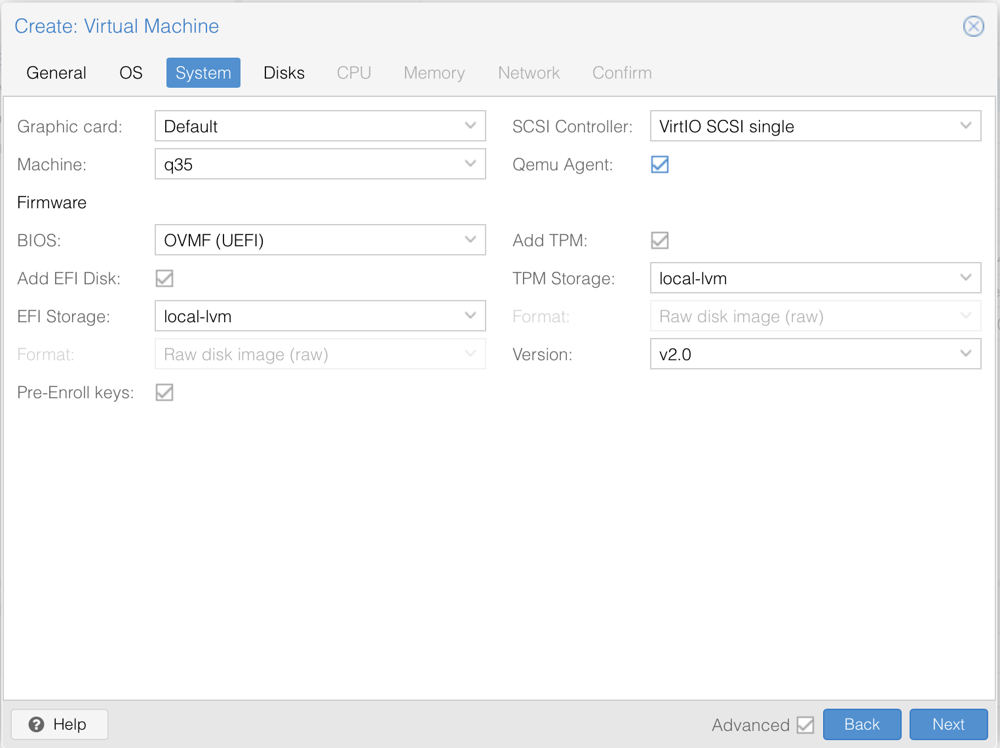
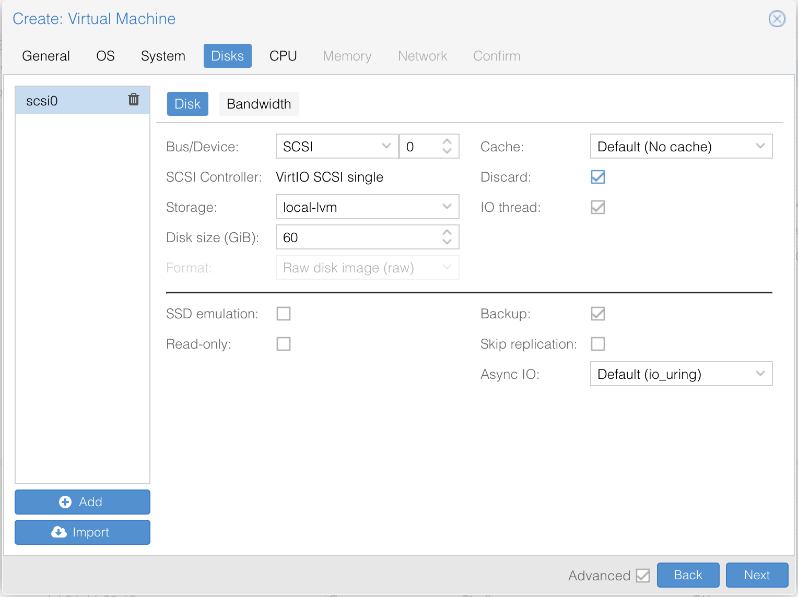
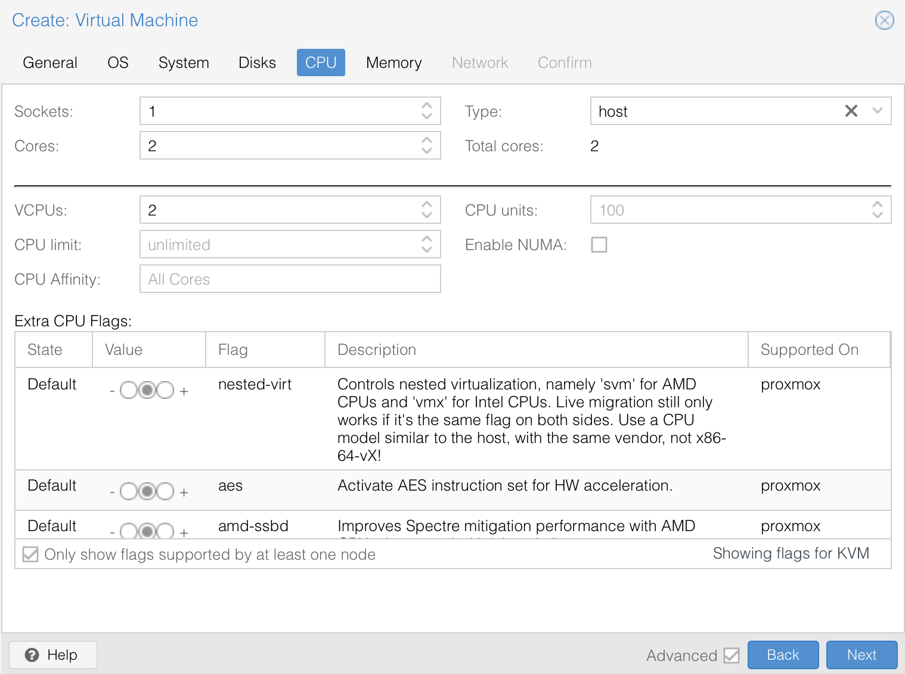
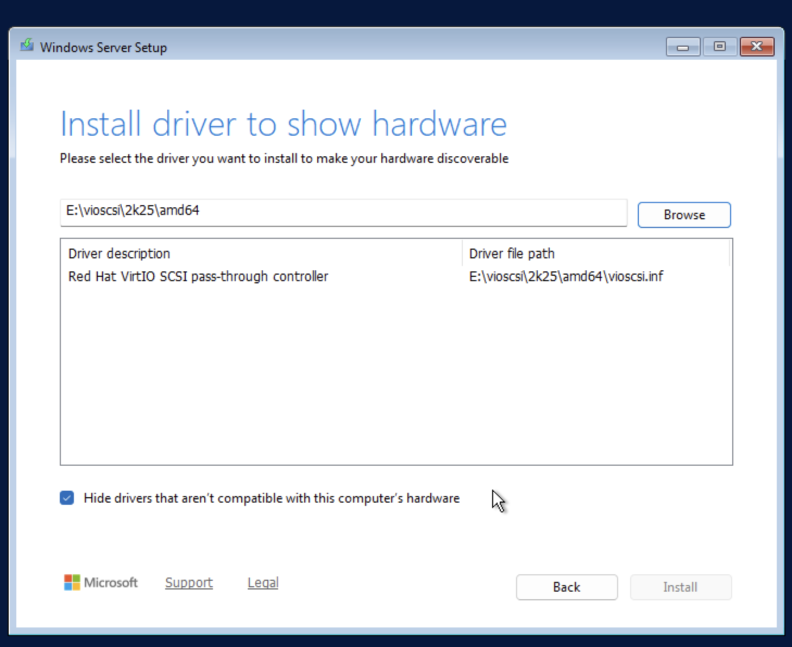
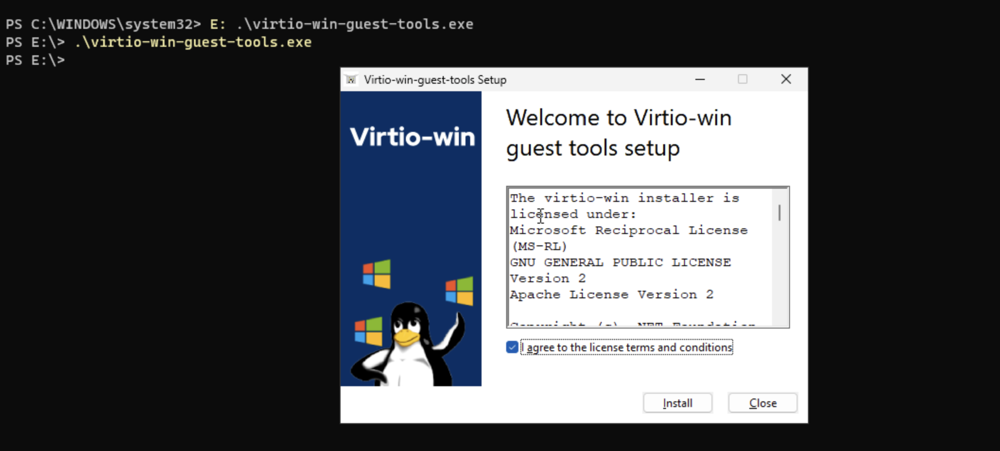
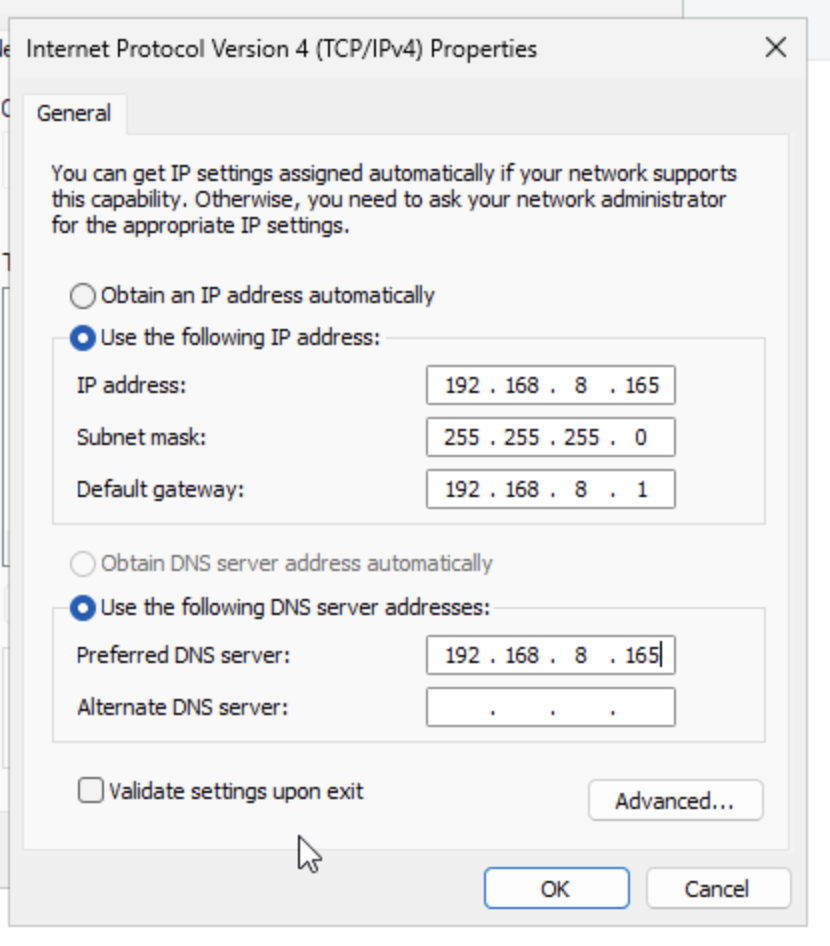
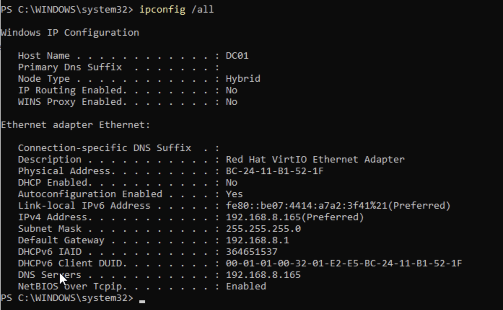

## Objective

Create and configure a Windows Server 2025 virtual machine in Proxmox VE for use as the lab’s Windows administration platform. The server will host Active Directory Domain Services, DNS, Group Policy, and the Wazuh agent.

## Environment

| Component               | Configuration                                                                                    |
| ----------------------- | ------------------------------------------------------------------------------------------------ |
| Operating System        | Windows Server 2025 Standard Evaluation                                                          |
| Installation Type       | Desktop Experience                                                                               |
| Hostname                | DC01                                                                                             |
| IP Address              | DHCP initially; static or reserved address to be configured before Active Directory installation |
| Server Role             | Planned Active Directory Domain Controller and DNS Server                                        |
| Virtualization Platform | Proxmox VE                                                                                       |
| Proxmox Network Bridge  | vmbr0                                                                                            |
| Virtual CPUs            | 2 vCPUs                                                                                          |
| Memory                  | 4 GB                                                                                             |
| Virtual Disk            | 60 GB                                                                                            |
| Disk Controller         | VirtIO SCSI                                                                                      |
| Network Adapter         | VirtIO                                                                                           |
| Firmware                | OVMF UEFI                                                                                        |
| Virtual TPM             | TPM 2.0                                                                                          |
| Guest Integration       | QEMU Guest Agent                                                                                 |
| Driver Package          | VirtIO Windows Drivers                                                                           |
| Lab Subnet              | 192.168.8.0/24                                                                                   |
| Default Gateway         | 192.168.8.1                                                                                      |
| DNS Server              | 192.168.8.165 initially                                                                          |
| Installation ISO        | Windows Server 2025 Evaluation ISO                                                               |
| Driver ISO              | virtio-win.iso                                                                                   |

## Prequisites

- Proxmox

# Procedure

1. Download the Windows 2025 Server ISO file from Windows and add it to the iso file folder in Proxmox
2. Download the virtio-win.iso file from https://fedorapeople.org/groups/virt/virtio-win/direct-downloads/archive-virtio/virtio-win-0.1.285-1/ and add that to the iso file folder as well
3. Hit 'Create VM' in Proxmox
4. In 'General', name your VM and leave the rest at the default
   

5. In 'OS', select your server iso file, change guest OS to Windows, add an additional drive, and select your virtio-win.iso
   

6. In 'System', use the local-lvm for both EFI Storage and TPM Storage. Check Qemu Agent. This allows Proxmox to see the VM’s correct IP address, shut down or reboot Windows cleanly, freeze and thaw the filesystem during backups for more consistent snapshots, report certain guest information back to Proxmox, and execute supported management actions inside the VM
   

7. In 'Disks', I used 60 GB of disk space. Also check 'discard' because it lets Windows send TRIM/unmap commands so deleted space can be reclaimed by the thin-provisioned storage.
   

8. In 'CPU', I used 2 cores, which should be enough for a small server such as mine. Additionally, I have to be wary of the Ubuntu hosting Wazuh on that same PC. Use 'host' for the type and set VCPUs to 2 so the server is aware it has 2.
9. In 'Memory', I used 4GB of RAM and turned ballooning off because I want fixed memory in this lab setting. I only have 2 VMs, so no need.
10. In 'Network', leave the default settings. vmbr0 will allow the server to be bridged onto my network and receive an IP address.
11. Click 'Finish' and allow it to create. Then start the server and open the console.
12. After starting the Server, select English and accept all agreements. Select the Desktop Experience for a better User Interface. 
    

13. You will then be asked to select the location to install. This is where the driver is important. Select 'Load driver' -> select your driver -> vioscsi\2k25\amd64
14. Your disk will then pop up, and you may select it. Click 'Install'.
15. Create your credentials
16. Log in, and you will be directed to the server manager dashboard. Click 'Local Server' and locate your computer name. Change that to whatever you'd like. I chose DC01 because this will be domain controller one in my network.
17. Proceed to restart the server as directed by the pop-up.
	
    
18. Open PowerShell and run 'E: .\virtio-win-guest-tools.exe' to install the drivers we initially input as an ISO so the server can access the network adapter.
19. Now we have to set the IP address to be static and set up the DNS settings. Open the 'Control Panel' -> 'Network and Internet' -> 'Network and Sharing Center' -> 'Change adapter settings' -> Click your connection -> 'Properties' -> 'IPV4' -> 'Properties'.
    

20. Make the IP address an open address on your network, make the mask the correct range for your network, the gateway your router's address, and the preferred DNS server your server's IP address again, as it will serve as the DNS. Leave the alternate blank.
    

21. Run 'ipconfig /all' to verify everything is correct
22. Return to the wallpaper screen and see the bottom right, there is a circle with a red dot. Click this to update Windows Server. If this pop-up isn't there, go to Settings and click 'Windows Update' on the left.
