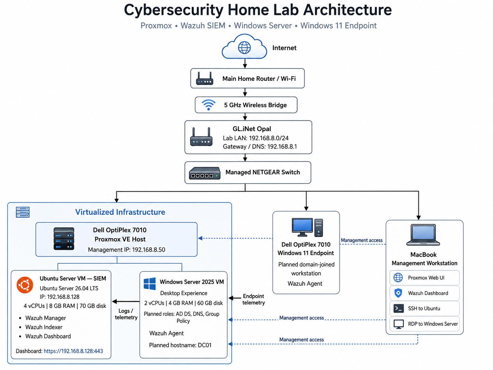

---
title: Owen Miele's Home Lab
description: A documented virtualized cybersecurity lab built with Proxmox, Wazuh SIEM, Windows Server, Active Directory, and Ubuntu Server.
---

A virtualized cybersecurity lab built with Proxmox, Wazuh SIEM, Windows Server 2025, Active Directory, Ubuntu Server, and Windows Workstations

## Project Overview

This lab provides hands-on experience with virtualization, centralized security monitoring, Windows administration, networking, and incident analysis.

## Documentation

- [Proxmox Installation](1.%20Proxmox/Proxmox%20Install.md)
- [Windows Server Installation](2.%20Windows%20VM%20Server/Windows%20VM%20Server%20Install.md)
- [Ubuntu Server Installation](3.%20Ubuntu%20VM%20Server/Ubuntu%20VM%20Install.md)
- [Active Directory](4.%20Active%20Directory/Active%20Directory.md)
- [Wazuh Installation](5.%20Wazuh%20SIEM/Wazuh%20Install.md)
- [Wazuh Agent Deployment](5.%20Wazuh%20SIEM/Wazuh%20Agent%20Deployment.md)

## Current Status

- Proxmox VE installed and configured
- Ubuntu Server VM running Wazuh SIEM
- Windows Server 2025 VM deployed
- Active Directory, DNS, Group Policy, and endpoint enrollment in progress
